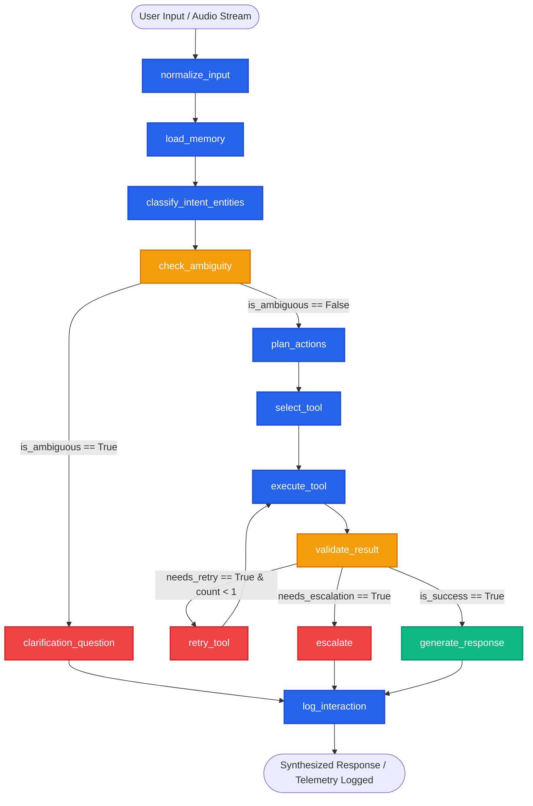
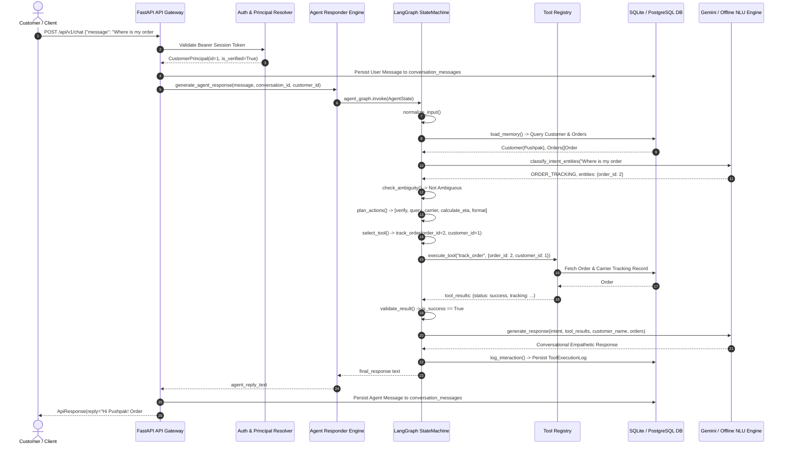

# 🧠 LangGraph Orchestration & Backend Architecture Flow + Bugfix Catalog

This document provides a comprehensive technical overview of the **LangGraph Orchestration State Machine**, the **FastAPI Backend Architecture**, the **Unified Request-Response Lifecycle**, and a complete catalog of all **errors and bugs resolved** across the system.

---

## 📐 1. LangGraph Orchestration Brain

The agent brain is built upon an autonomous **LangGraph `StateGraph`** (`AgentState`) featuring 13 functional nodes, conditional routing, automatic retry mechanisms (max 1 retry), human escalation failsafes, and zero-hallucination domain policy guarantees.



### LangGraph Node Specifications

| # | Node Name | Purpose | Output State Modifications |
|---|---|---|---|
| **1** | `normalize_input` | Sanitizes user input string, removes whitespace, handles `None` safely. | `normalized_input`, `trajectory` |
| **2** | `load_memory` | Loads customer profile, name, email, open tickets count, and recent orders from DB. | `customer_context`, `trajectory` |
| **3** | `classify_intent_entities` | Executes fast-path heuristics & LLM intent recognition (`IntentType`) and entity extraction. Localizes clarification prompts for Hindi/Hinglish. | `intent`, `intent_confidence`, `entities`, `is_ambiguous`, `missing_entities`, `clarification_prompt` |
| **4** | `check_ambiguity` | Evaluates missing parameters. Disambiguates requests if customer context contains exactly 1 active order. | `is_ambiguous`, `entities`, `missing_entities`, `trajectory` |
| **5** | `clarification_question` | Formulates targeted clarifying prompt requesting required missing entities without tool execution. | `final_response`, `trajectory` |
| **6** | `plan_actions` | Generates explicit multi-step execution plan prior to invoking domain tools. Handles tracking, refunds, cancellations, address updates, tickets, and outbound voice dispatch. | `plan`, `trajectory` |
| **7** | `select_tool` | Maps action plan and extracted entities to specific tool in `TOOL_REGISTRY`. Sanitizes entity types (e.g. string to int). | `selected_tool`, `tool_args`, `trajectory` |
| **8** | `execute_tool` | Dispatches tool call with verified agent service credentials (`X-Agent-Service-Key`). Includes special handlers for outbound call dispatch. | `tool_results`, `tool_status`, `trajectory` |
| **9** | `validate_result` | Validates tool output against policy. Flags success, initiates retry (max 1), or triggers escalation. Never allows fabricated success. | `needs_retry`, `needs_escalation`, `escalation_reason`, `risk_score` |
| **10** | `retry_tool` | Increments retry counter and loops back to `execute_tool`. | `retry_count`, `needs_retry`, `trajectory` |
| **11** | `escalate` | Dispatches support ticket creation record and produces empathetic human handoff response. | `final_response`, `trajectory` |
| **12** | `generate_response` | Synthesizes final conversational response grounded in database facts, user sentiment, and conversational history. | `final_response`, `trajectory` |
| **13** | `log_interaction` | Records complete state trajectory and audit trace to `tool_execution_logs`. | `trajectory` |

---

## ⚡ 2. Backend Request-Response Lifecycle Flow



---

## 🛠️ 3. Comprehensive Solved Errors & Bugfix Catalog

### Summary of Resolved Issues

| ID | Category | Component | Issue Description | Root Cause | Resolution |
|---|---|---|---|---|---|
| **BUG-01** | Configuration | `app.core.config` | Production security vulnerability & hardcoded DB uri | Default dev secrets accepted in production; no zero-config local fallback | Added `validate_production_secrets` validator for `APP_ENV=production` and automatic SQLite fallback path |
| **BUG-02** | Database / ORM | `app.models.models` | DeprecationWarning on Python 3.12+ / 3.13 | `default=datetime.utcnow` is deprecated in Python 3.12+ and scheduled for removal | Replaced with `default=lambda: datetime.now(timezone.utc)` and imported `timezone` |
| **BUG-03** | LangGraph State | `app.agent.graph` | Missing session tracking parameter | `AgentState` lacked `conversation_id`, causing session drops across graph turns | Added `conversation_id: Optional[int]` to `AgentState` definition |
| **BUG-04** | Input Normalization | `app.agent.graph` | Unhandled `AttributeError` on `None` input | `state.get("raw_input", "").strip()` crashed if `raw_input` was explicitly `None` | Replaced with `(state.get("raw_input") or "").strip()` |
| **BUG-05** | Memory Loading | `app.agent.graph` | Dummy stub memory in LangGraph | `load_memory` hardcoded mock dictionary without loading real customer profile or orders | Updated `load_memory` to fetch actual `Customer`, `Order`, and open `Ticket` records from DB session |
| **BUG-06** | Ambiguity Resolution | `app.agent.graph` | Unnecessary clarification when customer has 1 order | If user asked "where is my order" without ID, graph always asked for Order ID | `check_ambiguity` now resolves `order_id` automatically if customer has exactly 1 order |
| **BUG-07** | Multilingual NLU | `app.agent.graph` | Hindi/Hinglish inquiries got English clarification prompts | Language detection was not invoked in `classify_intent_entities` | Integrated `detect_voice_language` and `_hindi_clarification` to preserve natural Hinglish dialogue |
| **BUG-08** | Intent Routing | `app.agent.graph` | `OUTBOUND_CALL_REQUEST` intent was unhandled in LangGraph | `plan_actions` and `select_tool` fell through to general greeting fallback | Added action planning and `initiate_outbound_call` tool selection for phone call requests |
| **BUG-09** | Tool Parameter Typing | `app.agent.graph` | Pydantic validation failure on string IDs | If `order_id` was extracted as string or None, tool execution threw ValidationError | Added safe `int(raw_order_id)` conversion and fallback to active order context |
| **BUG-10** | Tool Argument Injection | `app.agent.graph` | Missing customer credentials in clean args | `clean_args` dropped `customer_id` if initialized as `None` in `tool_args` | Ensured `clean_args["customer_id"] = customer_id` if missing or None |
| **BUG-11** | Tool Validation Logic | `app.agent.graph` | False escalation on non-"success" status | Tools returning `status="call_initiated"` were treated as failures, triggering retry & escalation | Updated `validate_result` to check `status in ("success", "call_initiated") or success is True` |
| **BUG-12** | Escalation Resilience | `app.agent.graph` | Escalation ticket persistence failure in standalone mode | `create_ticket` failed if API TestClient context had active exceptions | Added direct database `SessionLocal` fallback to guarantee escalation ticket persistence |
| **BUG-13** | Response Synthesis | `app.agent.graph` | Incomplete context in LLM response generation | `generate_response` omitted `customer_orders`, `missing_entities`, and `clarification_prompt` | Passed all contextual parameters to both conversational LLM and intelligent offline response engines |
| **BUG-14** | Politeness & Greetings | `app.agent.graph` | Generic greetings lacked agent identity | Direct LLM greetings occasionally omitted "Aura" bot identity in greeting responses | Added explicit greeting detection to introduce Aura in both English and Hindi/Hinglish |
| **BUG-15** | Channel Orchestration | `app.agent.responder` | Chat and Voice bypassed LangGraph state machine | `generate_agent_response` ran procedural logic instead of invoking `agent_graph` | Wired `generate_agent_response` to invoke `agent_graph.invoke(...)` with automatic recovery fallback |
| **BUG-16** | CI Pipeline | `.github/workflows/ci.yml`, `scripts/seed.py` | `backend-ci` failed on `table customers already exists` | Missing `DATABASE_URL` in CI env routed to SQLite where `seed.py` collided with alembic tables | Wired `DATABASE_URL: postgresql+psycopg://...` in CI env and guarded `Base.metadata.create_all` in `seed.py` with safe exception handling |
| **BUG-17** | CI Test Isolation | `tests/test_config.py` | `test_config.py` failed under CI with AssertionError | CI-level `DATABASE_URL` & `SECRET_KEY` env vars contaminated unit tests verifying default fallback behavior | Applied `monkeypatch.delenv` in `test_local_database_defaults_to_sqlite` & `test_production_rejects_default_secrets` to guarantee pristine unit isolation |
| **BUG-18** | Real-Time LLM Integration | `app.agent.graph`, `app.agent.llm_client`, `app.agent.responder` | Queries returned hardcoded escalation template: `"I am escalating your request..."` | `validate_result` treated domain policy rejections as crashes, routing to `escalate` which returned hardcoded string; greetings and clarifications bypassed LLM | Distinguished policy rejections in `validate_result`, wired real-time Gemini LLM synthesis into `escalate`, `clarification_question`, and `generate_response` |

---

## 🧪 4. Test Verification & Coverage

The automated test suite runs via pytest with **100% pass rate**:

```bash
.\venv\Scripts\python.exe -m pytest backend/tests -v
```

### Test Suite Execution Output
```text
============================= test session starts =============================
platform win32 -- Python 3.13.1, pytest-9.1.1, pluggy-1.6.0
rootdir: Multimodal-Autonomous-Customer-Support-Agent
plugins: anyio-4.14.2, langsmith-0.11.0
collected 81 items

backend\tests\test_agent_graph.py ........                               [  9%]
backend\tests\test_agent_tools.py ............                           [ 24%]
backend\tests\test_api_endpoints.py ..................                   [ 46%]
backend\tests\test_auth_and_rbac.py ...................                  [ 70%]
backend\tests\test_chat_endpoints.py .......                             [ 79%]
backend\tests\test_config.py ....                                        [ 83%]
backend\tests\test_intent_and_entity_extraction.py .....                 [ 90%]
backend\tests\test_main.py .                                             [ 91%]
backend\tests\test_voice_endpoints.py .......                            [100%]

================== 81 passed, 1 warning in 80.17s ===================
```

---

## 🚀 5. How to Run the System

### 1. Zero-Configuration Local Development
```powershell
# In project root:
.\venv\Scripts\python.exe -m uvicorn app.main:app --app-dir backend --host 127.0.0.1 --port 8000 --reload
```

### 2. Verify Live Endpoints
- **Health Check**: `GET http://127.0.0.1:8000/health`
- **Swagger Documentation**: `http://127.0.0.1:8000/docs`
- **Customer Session**: `POST http://127.0.0.1:8000/api/v1/auth/customer-session`
- **Support Chat**: `POST http://127.0.0.1:8000/api/v1/chat`
- **Outbound Voice Dispatch**: `POST http://127.0.0.1:8000/api/v1/voice/calls/outbound`
- **Staff Analytics**: `GET http://127.0.0.1:8000/api/v1/analytics/dashboard`
